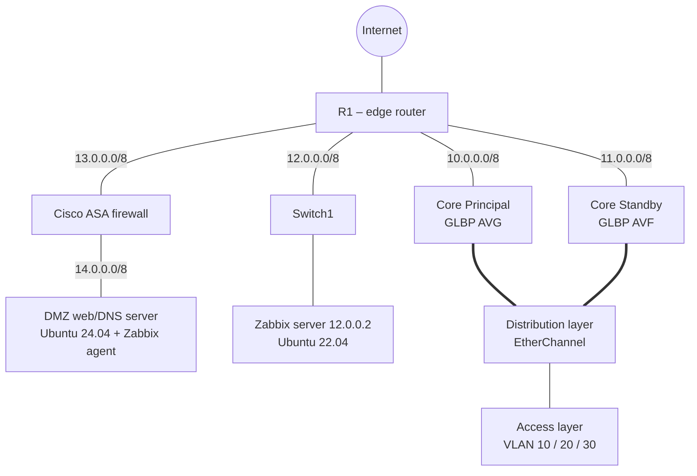

# Cisco Enterprise Network & Zabbix Monitoring

A campus-style Cisco network (Core / Distribution / Access) simulated in **GNS3** and supervised end-to-end with **Zabbix 7.2**: SNMPv3 for network devices, Zabbix agent for servers, custom dashboards, e-mail alerting, load-tested triggers, scheduled PDF reports and a live network map.

> Academic project — ENIAD Berkane, Networks module, 2025–2026. Lab environment only.

## Why this project

A resilient network is only useful if you can see what it is doing. The goal was to move from **reactive** maintenance (fix after the outage) to **proactive** maintenance (detect and alert before users notice), on top of a topology with real high-availability mechanisms.

## Architecture



*Simplified view — the full topology figure is in [`screenshots/`](screenshots/) once added.*

| Zone | Network |
|---|---|
| VLAN 10 – Management | 192.168.10.0/24 |
| VLAN 20 – Users A | 192.168.20.0/24 |
| VLAN 30 – Users B | 192.168.30.0/24 |
| R1 ↔ Core Principal | 10.0.0.0/8 |
| R1 ↔ Core Standby | 11.0.0.0/8 |
| R1 ↔ Switch1 (towards Zabbix) | 12.0.0.0/8 |
| R1 ↔ ASA | 13.0.0.0/8 |
| DMZ | 14.0.0.0/8 |

## What was built

### Network layer
- Hierarchical **Core / Distribution / Access** design with VLAN segmentation (10/20/30) propagated by **VTP**
- Inter-VLAN routing with **SVIs** on two core switches
- **EtherChannel** between Distribution and Core (port-channel groups 1-3 and 10-12)
- **GLBP** gateway redundancy and load balancing (virtual IP `.254` per VLAN; Core Principal = AVG, Core Standby = AVF)
- **EIGRP** across the backbone
- **Cisco ASA** for perimeter security, NAT and a **DMZ** hosting a web/DNS server (Nginx + Bind9)

### Monitoring layer
- **Zabbix 7.2** server (LAMP: Apache + MySQL) on Ubuntu 22.04
- **Hybrid strategy**: SNMP for network devices, Zabbix agent for servers
  - Switches: **SNMPv3 authNoPriv** (SHA)
  - Router and ASA: **SNMPv3 authPriv** (SHA + AES-128)
  - DMZ web server: Zabbix agent 7.2 on Ubuntu 24.04
- Custom **dashboards** ("ASA Monitoring", "Router Monitoring") with CPU and traffic widgets
- **E-mail alerting** through an SMTP relay (Gmail)
- **Triggers** covering availability (ICMP), performance (CPU / RAM) and network traffic
- **Scheduled PDF reports** (Zabbix Web Service + headless Chrome)
- Dynamic **network map** with link-state colouring and live In/Out throughput labels

## Validation

| Test | Method | Result |
|---|---|---|
| Host availability | All switches, router, ASA and servers added to Zabbix | Every host shows green SNMP / ZBX availability |
| Alert chain | Switch unreachable (ICMP failure) | Critical alert received by e-mail |
| CPU trigger load test | Trigger set artificially low (CPU > 2 %) on the main router, then SYN flood with `hping3` | Trigger fired, e-mail notification received |
| Self-monitoring | Disk usage of the Zabbix server | 72 % used (13.7 GB / 4.34 GB free), close to the 80 % warning threshold |
| Scheduled report | "Test" function on a daily dashboard report | PDF generated and e-mailed |

## Repository structure

```
configs/
  cisco/     SNMPv3 configuration for switches, router and ASA (credentials replaced by placeholders)
  linux/     Zabbix agent installation on Ubuntu 24.04
  zabbix/    zabbix_server.conf excerpt and Web Service / Chrome installation
docs/
  architecture.md          design details (SVI plan, GLBP, port-channels)
  zabbix-server-install.md Zabbix 7.2 server installation outline
  screenshots-checklist.md figure-by-figure list of images to add
screenshots/               topology, dashboards, alerts, reports, map
```

## Hardening ideas / next steps

From the original report:
- **Automated remediation** — couple Zabbix with Ansible so an alert can trigger a corrective action
- **Anomaly detection** — use Zabbix trend prediction to forecast disk or bandwidth saturation
- **Monitoring HA** — a Zabbix cluster so the monitoring server is not a single point of failure

Additional improvements worth making:
- Make the SNMPv3 view **read-only** and restrict it with an ACL to the Zabbix server IP
- Store SNMP and SMTP credentials in Zabbix secret macros instead of plain text

## Authors

El Mehdi Boussalem · Mohammed Saghir — supervised by Pr. Zineb Bakraouy (ENIAD Berkane).

## Disclaimer

Educational lab built in a simulated environment. Credentials appearing in the original report were lab-only and are replaced by placeholders here.
